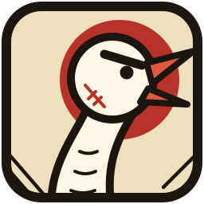
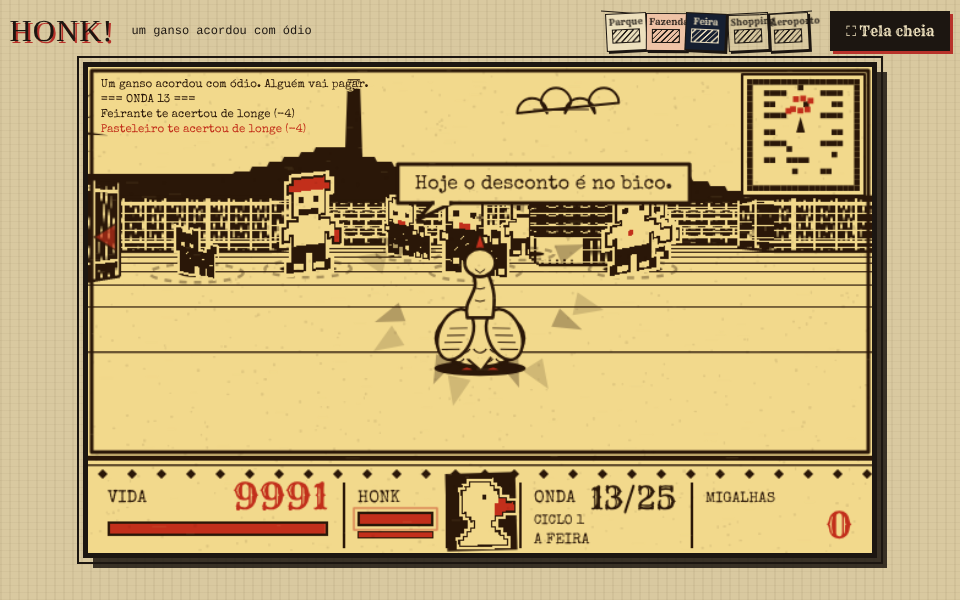
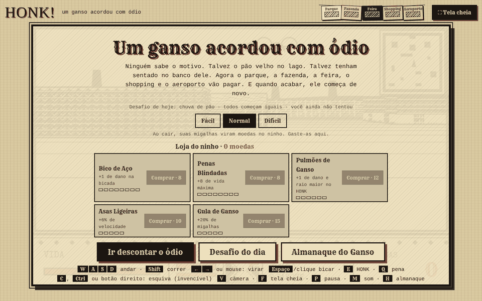
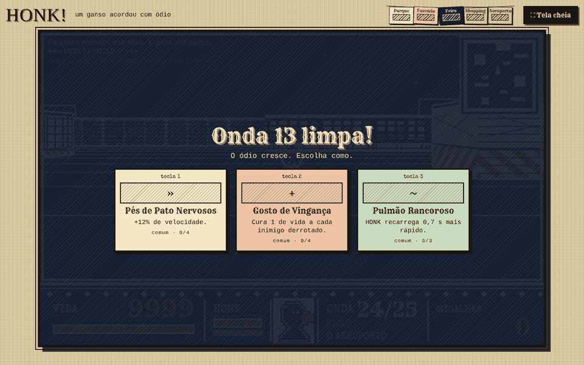
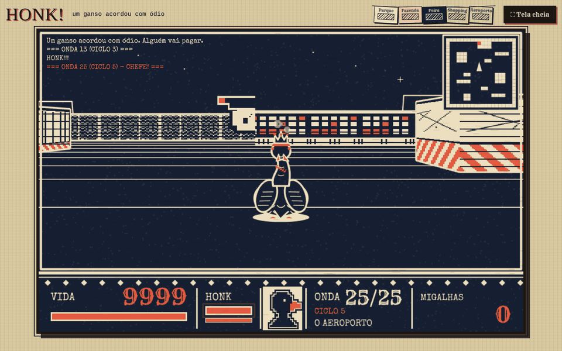
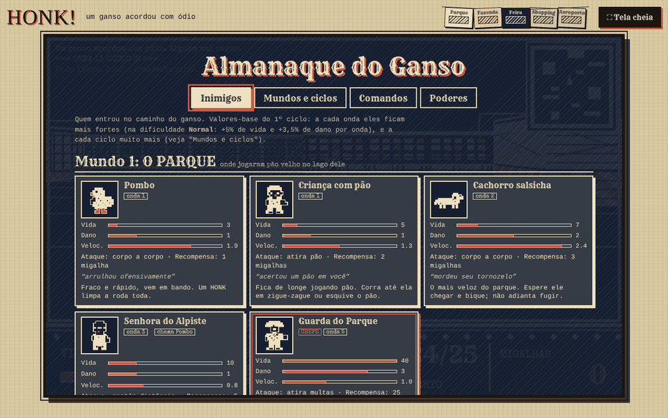

<div align="center">



# HONK!

**Um ganso acordou com ódio.**

Um roguelite em xilogravura de cordel cujo **motor é um banco de dados**:
todas as regras do jogo são **SQL**, rodando no [DuckDB](https://duckdb.org) dentro do navegador.

[](https://github.com/Jano-Projects/honk/actions/workflows/testes.yml)
[](https://github.com/Jano-Projects/honk/actions/workflows/lancamento.yml)
[](https://github.com/Jano-Projects/honk/releases/latest)
[](https://github.com/Jano-Projects/honk/releases)


[](LICENSE)

[**Baixar**](https://github.com/Jano-Projects/honk/releases/latest) · [Como jogar](#como-jogar) · [Como funciona](docs/arquitetura.md) · [Desenvolver](docs/desenvolvimento.md)



</div>

---

## Sumário

- [A ideia](#a-ideia) · [O jogo](#o-jogo) · [Como jogar](#como-jogar)
- [Como funciona](#como-funciona) · [Estrutura do repositório](#estrutura-do-repositório) · [Desenvolver](#desenvolver)
- [Documentação](#documentação) · [Autor](#autor) · [Licença](#licença)

---

## A ideia

Assim como o Minecraft provou que Java servia para jogos, o HONK! testa uma ideia
improvável: **e se o motor de um jogo fosse um banco de dados analítico?**

Aqui, o JavaScript só lê o teclado e "imprime" a tela. **Todo o resto é SQL**:
o estado do mundo, o movimento e a colisão, a inteligência dos inimigos (busca em largura
com CTE recursiva), o combate, as ondas, os ciclos, as cartas e até o
**raycasting 3D** — uma consulta que lança 320 raios por quadro.

## O jogo

Ninguém sabe o motivo. Talvez o pão velho no lago. Talvez tenham sentado no banco dele.
Agora **o Parque, a Fazenda, a Feira, o Shopping e o Aeroporto** vão pagar — e quando
acabar, ele começa de novo.

- **Ciclos sem fim**: 5 lugares × 5 ondas, um chefe a cada 5 (Guarda do Parque, Espantalho,
  Caminhão do Gás, Papai Noel do Shopping, Airbus). Depois do Airbus, volta ao Parque.
- **A dificuldade mede você**: do 2º ciclo em diante, os inimigos crescem conforme a força do
  ganso e ainda multiplicam a cada volta. Primeiro limite: cartas e loja têm teto. Segundo: a sua habilidade.
- **Combate de habilidade**: esquiva com invencibilidade, **esquiva perfeita** (câmera lenta +
  crítico garantido), chefes que **avisam** antes de atacar, **combos** de cartas.
- **Progressão**: loja do ninho, **Penas de Ouro** sem limite, **desafio do dia** igual para todos.
- **Um ganso que evolui**: cicatriz, bandana, olhos em brasa e coroa a cada ciclo.
- **Clima**: trilha gerada por código que acelera nos chefes, falas ranzinzas e um placar engraçado no fim.

<table>
<tr>
<td></td>
<td></td>
</tr>
<tr>
<td></td>
<td></td>
</tr>
</table>

## Como jogar

Baixe o instalador do seu sistema na [página de lançamentos](https://github.com/Jano-Projects/honk/releases/latest):

| Sistema | Arquivo | Como instalar |
|---|---|---|
| **Windows 10/11** | `HONK-…-instalador-windows.exe` | Avançar, Avançar, Concluir. Cria o ícone na Área de Trabalho. |
| **Debian / Ubuntu / Mint** | `honk_…_all.deb` | Dois cliques, ou `sudo apt install ./honk_…_all.deb` |
| **Fedora** | `honk-…noarch.rpm` | Dois cliques, ou `sudo dnf install ./honk-…noarch.rpm` |
| **macOS** | `HONK-…-macos.zip` (ou `.dmg`) | Descompacte e arraste o HONK.app para Aplicativos. Na 1ª vez: botão direito › Abrir (o app não é assinado pela Apple). |
| **Sem instalar** | `HONK-…-portatil.zip` | Descompacte e abra o lançador do seu sistema. |

O ícone abre o jogo numa **janela própria** do Edge, Chrome, Brave ou Chromium — sem terminal,
sem barra de endereço — e ele roda **100% offline**: o motor vai junto no instalador.

**Comandos:** `W A S D` andam · mouse ou `← →` viram · `Espaço`/clique bica · `E` HONK ·
`C`/`Ctrl`/botão direito esquiva · `Q` pena · `1 2 3` escolhem cartas · `H` abre o **Almanaque**
(inimigos, mundos, regras e todos os comandos) · `V` câmera · `F` tela cheia · `M` som.

## Como funciona

```
 teclado/mouse ──► JavaScript ──► tabela `entrada` ──► REGRAS SQL (DuckDB-WASM) ──► uma consulta de saída
                                                                                    │ paredes (raycasting)
       tela (canvas, estilo xilogravura) ◄── JavaScript desenha e interpola ◄──────┤ sprites projetados
                                                                                    └ HUD + sinais de eventos
```

- **SQL decide, JavaScript imprime.** O banco devolve, a cada passo, as colunas de parede, os
  sprites já projetados na tela e o HUD; o JavaScript só desenha e anima entre um passo e outro.
- **Dois ritmos.** A simulação SQL roda ~15–60 vezes por segundo; o desenho, a 60 quadros por
  segundo, com previsão de movimento para ficar liso mesmo em máquina fraca.
- **Eventos sob demanda.** O HUD traz "sinais" (`f_ataque`, `f_onda`…) e só as regras necessárias rodam.

Detalhes, decisões e truques de desempenho em [docs/arquitetura.md](docs/arquitetura.md).

## Estrutura do repositório

```
jogo/                       o código-fonte, destrinchado
├── index.html              a casca da página (marcadores @css, @sql, @js)
├── css/estilo.css          moldura, menus, cartas, almanaque
├── sql/
│   ├── esquema/            tabelas e dados: mundos, mapas, bestiário, cartas, sprites em pixel art…
│   ├── regras/             o que roda a cada passo: mover, bicar, HONK, esquiva, inimigos…
│   ├── eventos/            o que roda quando o HUD pede: ataques, tiros, ondas, mortes…
│   ├── menus/              cartas, lojas, dificuldade, desafio do dia, save
│   └── visao/              raycasting, sprites, HUD e a consulta de saída
└── js/                     00-base … 14-partida, em ordem de execução
ferramentas/
├── montar.py               junta tudo em dist/index.html (e serve em modo desenvolvimento)
├── baixar-motor.sh         monta vendor/: o módulo do motor (de motor/) + workers, .wasm e fontes
├── motor/                  módulo do DuckDB-WASM com o apache-arrow dentro (e o gerar.sh dele)
├── notas-da-versao.py      texto da página de Releases, tirado do CHANGELOG.md
└── configurar-github.sh    proteções, segurança e rótulos do repositório no GitHub
testes/                     testes das regras SQL + robôs (caçador de bugs e de equilíbrio)
empacotar/                  ícone, instaladores (Windows, Linux, macOS) e lançadores
portatil/                   lançadores da versão sem instalar
.github/                   testes a cada envio; instaladores, homologação e release a cada tag;
                            modelos de issue e de pull request; Dependabot
docs/                       arquitetura, desenvolvimento, homologação e capturas
```

## Desenvolver

```sh
sh ferramentas/baixar-motor.sh            # uma vez: motor DuckDB + fontes em vendor/
python3 ferramentas/montar.py --servir    # http://localhost:8080 — edite em jogo/ e aperte F5
pip install duckdb && python3 -m unittest discover -s testes -v
```

Empacotar, publicar uma versão e o passo a passo completo: [docs/desenvolvimento.md](docs/desenvolvimento.md).

## Documentação

O [índice da documentação](docs/README.md) indica por onde começar conforme o que você quer fazer.

| Para quem joga | Técnico |
|---|---|
| [Como jogar](#como-jogar) e o Almanaque do jogo (tecla **H**) | [Arquitetura](docs/arquitetura.md): como o banco vira motor de jogo |
| [Onde fica o progresso salvo](docs/desenvolvimento.md#onde-ficam-os-dados-do-jogador) | [Desenvolvimento](docs/desenvolvimento.md): editar, testar, empacotar e publicar |
| [Mudanças](CHANGELOG.md) | [Homologação](docs/homologacao.md): como cada versão é conferida |
| [Segurança](SECURITY.md): o que o jogo faz no seu computador | [Como contribuir](CONTRIBUTING.md) · [Código de conduta](CODE_OF_CONDUCT.md) |

## Autor

**Victor Hugo dos Santos Correa**, desenvolvedor Oracle PL/SQL. [LinkedIn](https://www.linkedin.com/in/victor-hsc) · [GitHub @Jano-Projects](https://github.com/Jano-Projects)

## Licença

Copyright © 2026 Victor Hugo dos Santos Correa.

[GPL-3.0](LICENSE): você pode usar, estudar, modificar e redistribuir; versões modificadas
distribuídas também precisam ter o código aberto sob a mesma licença.

Componentes de terceiros, baixados na montagem e distribuídos com os instaladores:
[DuckDB-WASM](https://github.com/duckdb/duckdb-wasm) (MIT),
fontes [Rye](https://fonts.google.com/specimen/Rye) e [Special Elite](https://fonts.google.com/specimen/Special+Elite) (OFL / Apache-2.0).
